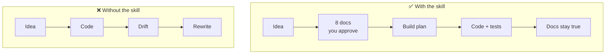
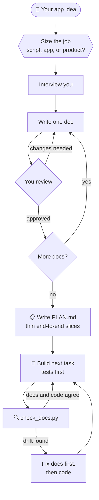
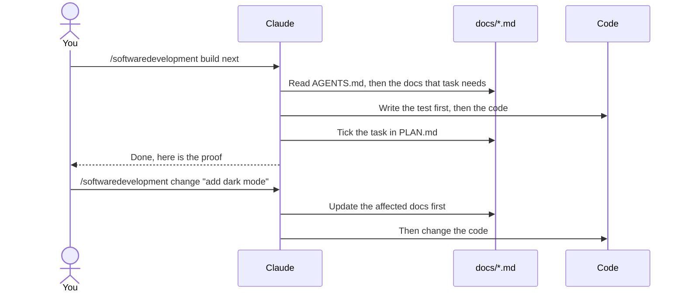
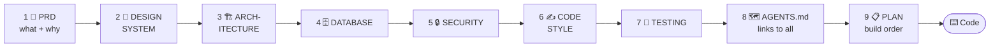
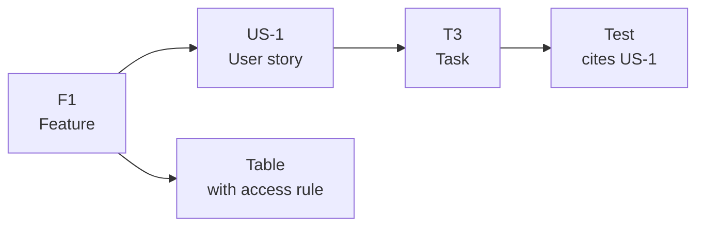
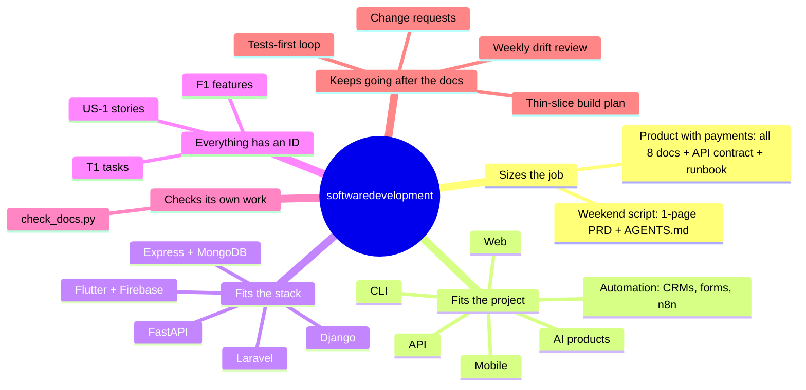

<div align="center">

# 🧭 softwaredevelopment

### Plan on paper first. Build against the plan. Keep both in agreement.

A Claude skill that writes **8 reviewed project docs** and a **build plan** before any code exists, then keeps docs and code from drifting apart.


[The idea](#-the-main-idea) · [How it works](#-how-it-works) · [Commands](#-commands) · [Install](#-install) · [Example](#-worked-example)

</div>

---

## 💡 The main idea

AI coding agents start every session with an **empty memory**. Without written decisions they drift:

| Without a plan | What goes wrong |
|---|---|
| 🌀 No written scope | Features nobody asked for |
| 🎨 No design rules | A different button style on every screen |
| 🔓 No data rules | Tables any signed-in user can read |
| ✅ No test rules | "Done" that was never tested |

**The fix:** write each decision down **once**, in files every agent rereads, and stop for your review after each one.



---

## 🔄 How it works



### The loop after the docs



---

## 🌳 What it writes

```
your-project/
├── 🗺️  AGENTS.md              map for every AI agent: commands, rules, which doc to read when
├── 🤖 CLAUDE.md              imports AGENTS.md (for Claude Code)
└── 📁 docs/
    ├── 🎯 PRD.md             what we build, for whom, and what we don't
    ├── 🎨 DESIGN_SYSTEM.md   how it looks
    ├── 🏗️  ARCHITECTURE.md    how the parts fit
    ├── 🗄️  DATABASE.md        what data we store and who may touch it
    ├── 🔒 SECURITY.md        what must never go wrong
    ├── ✍️  CODE_STYLE.md      how code is written here
    ├── 🧪 TESTING.md         how we prove it works
    └── 📋 PLAN.md            the build order, one small task at a time
```

### How the docs connect

The docs are written in this order. Each one builds on the ones before it, and AGENTS.md links to all of them:



### Everything has an ID

Features, stories and tasks are cited across docs, tests and the plan, so gaps become visible.



---

## 🕹️ Commands

| You type | Claude does |
|---|---|
| `/softwaredevelopment` | Asks for your app idea, then runs the full flow |
| `/softwaredevelopment <app idea>` | Interviews you and writes the docs one at a time, stopping for approval after each |
| `/softwaredevelopment <doc>` | Writes or redoes one doc (`prd`, `security`, `agents`...) |
| `/softwaredevelopment existing` | Documents a project that already has code, then lists where the code breaks its own rules |
| `/softwaredevelopment status` | Shows each doc's status, open questions and the next step |
| `/softwaredevelopment audit` | Checks the docs for gaps, vague rules and contradictions |
| `/softwaredevelopment plan` | Writes the build plan |
| `/softwaredevelopment build next` | Builds the next task (or `build F1`, `build T3`) |
| `/softwaredevelopment change <what>` | Updates the affected docs first, then the code |
| `/softwaredevelopment review` | Lists every place docs and code disagree |

Plain requests work as well: *"plan my app"*, *"document this repo"*, *"are my docs still right?"*

---

## ⭐ What's different from a prompt template



### 🔍 What the checker catches

A bundled script finds mechanical mistakes before they reach production:

| Check | Example it catches |
|---|---|
| Features without stories | A P0 feature with no user story |
| Tables without rules | A table with no access rule |
| Leftover placeholders | `TODO` text in an approved doc |
| Fake commands | A command in AGENTS.md that isn't in `package.json` |
| Undocumented tables | A table in the migrations the docs never mention |

---

## 📦 Install

### Claude app

1. Download [`dist/softwaredevelopment.zip`](dist/softwaredevelopment.zip).
2. In Claude, open **Customize > Skills**, press **+**, choose **Create skill**, then **Upload a skill**.
3. Upload the zip and make sure the skill is switched on.

> Skills need "Code execution and file creation" to be enabled under Settings > Capabilities. Menu names change from time to time; Anthropic's current steps are in [Use skills in Claude](https://support.claude.com/en/articles/12512180-use-skills-in-claude).
>
> If you already have an older `softwaredevelopment` skill, remove it first so the two don't clash.

### Claude Code

Copy the `softwaredevelopment` folder into your skills folder:

```bash
# for every project
cp -r softwaredevelopment ~/.claude/skills/

# or for one project only
cp -r softwaredevelopment your-project/.claude/skills/
```

---

## 🛠️ Using the scripts yourself

Claude runs these for you, but they work on their own too. Python 3.9 or newer, no packages to install.

```bash
# copy one doc's template into a project (never overwrites)
python3 softwaredevelopment/scripts/init_docs.py path/to/project --doc prd --name "My App"

# check the docs against each other and against the code
python3 softwaredevelopment/scripts/check_docs.py path/to/project
python3 softwaredevelopment/scripts/check_docs.py path/to/project --json     # for CI
python3 softwaredevelopment/scripts/check_docs.py path/to/project --strict   # warnings fail too
```

The checker exits with 1 when it finds errors, so it can run in CI. Try it on the example:

```bash
python3 softwaredevelopment/scripts/check_docs.py examples/studyplan
```

> It is a net for mechanical mistakes. It can't tell whether a decision is a good one; `audit` has Claude read for that.

---

## 🎓 Worked example

A complete set of docs for a sample app is in [`examples/studyplan`](examples/studyplan). Open it to see what the finished output looks like.

---

## 📂 What's in this repository

```
softwaredevelopment-skill/
├── 📦 softwaredevelopment/        the skill (this folder is what gets installed)
│   ├── SKILL.md                   the instructions Claude follows
│   ├── references/                one guide per doc, plus project types, modes and extra docs
│   ├── assets/templates/          a skeleton for every doc
│   └── scripts/                   init_docs.py and check_docs.py
├── 🎓 examples/studyplan/         a full set of docs for a sample app
├── 🎁 dist/softwaredevelopment.zip   ready to upload
├── LICENSE
└── README.md
```

To rebuild the zip after changing the skill:

```bash
rm -f dist/softwaredevelopment.zip
zip -r dist/softwaredevelopment.zip softwaredevelopment -x "*/__pycache__/*" "*.pyc" "*.DS_Store"
```

---

## 🙏 Credits

The eight-doc method follows the free guide "8 Docs Before You Vibe Code" by @kgtechtalks. This skill is an independent rewrite that adds project sizing, project types, stack translation, the build plan and loop, change requests, the checker and the worked example.

## 📄 License

MIT. See [LICENSE](LICENSE).
